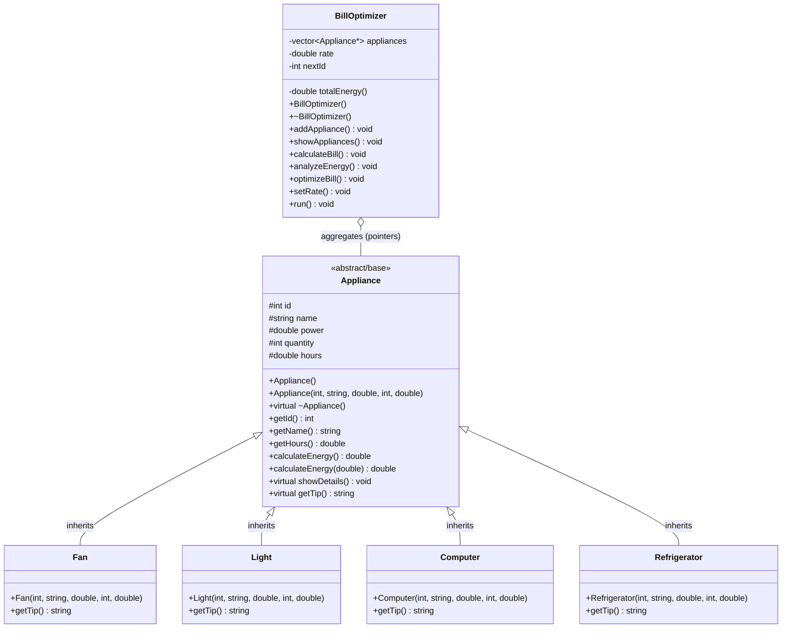
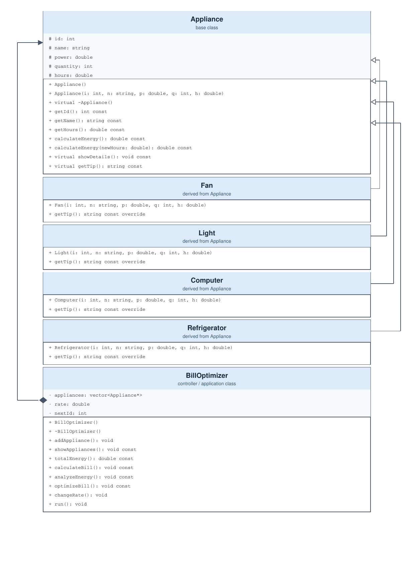
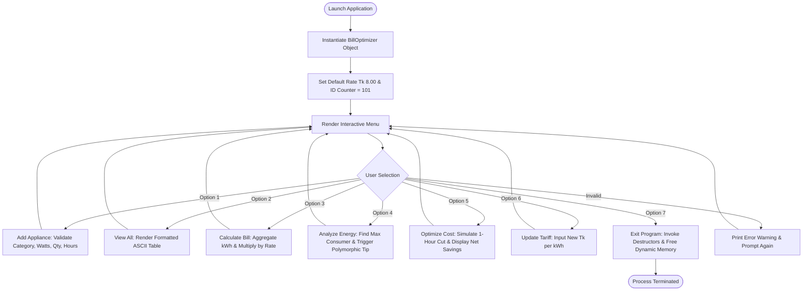
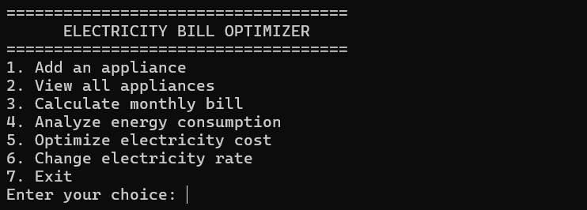
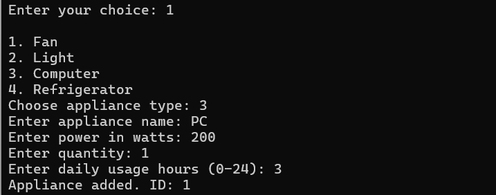
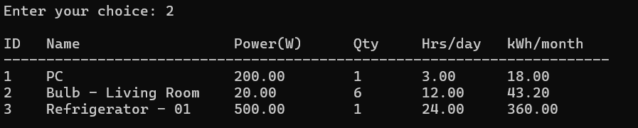
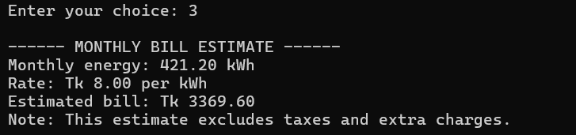
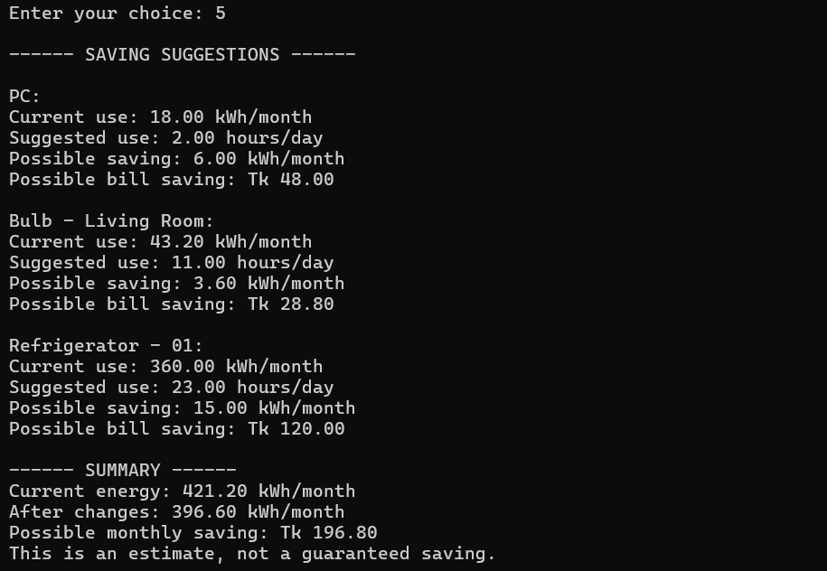

# ⚡ Electricity Bill Optimizer

[](https://en.wikipedia.org/wiki/C%2B%2B)
[](https://www.kuet.ac.bd)
[](https://www.kuet.ac.bd)
[](../LICENSE)
[]()

> **A menu-driven Object-Oriented C++ application designed to audit household electrical energy consumption, calculate monthly utility expenses, identify high-draw appliances, and simulate cost-reduction strategies through usage optimization.**

Developed for **CSE 2100: Object-Oriented Programming Laboratory**, Department of Computer Science and Engineering, **Khulna University of Engineering & Technology (KUET)**.

---

## 📋 Table of Contents
- [Project Overview](#-project-overview)
- [Key Features](#-key-features)
- [System Architecture & UML Diagram](#-system-architecture--uml-diagram)
- [Object-Oriented Programming Concepts](#-object-oriented-programming-concepts)
- [Mathematical Formulation](#-mathematical-formulation)
- [Program Workflow](#-program-workflow)
- [Screenshots & Visual Walkthrough](#-screenshots--visual-walkthrough)
- [Input Validation & Boundary Checks](#-input-validation--boundary-checks)
- [Technical Evaluation & Limitations](#-technical-evaluation--limitations)
- [Future Enhancements](#-future-enhancements)
- [Build & Execution Guide](#-build--execution-guide)
- [Documentation & Project Artifacts](#-documentation--project-artifacts)

---

## 💡 Project Overview

Residential electricity expenses often increase unexpectedly because users lack insight into how individual appliances contribute to their monthly billing. While high-power appliances (e.g., air conditioners or refrigerators) run continuously or periodically, continuous use of lower-wattage appliances (e.g., lighting arrays and desktop computers) can also result in significant energy charges.

The **Electricity Bill Optimizer** addresses this challenge through an interactive simulation and calculation platform:
1. **Audits Appliance Inventory**: Collects operational specifications (power in Watts, quantity, daily usage hours) across multiple equipment categories.
2. **Computes Energy Consumption**: Converts instantaneous wattage into monthly kilowatt-hours ($\text{kWh}$).
3. **Applies Tariff Rates**: Calculates total monthly utility expenses based on configurable electricity rates (default: $\text{Tk } 8.00/\text{kWh}$).
4. **Identifies Energy Hotspots**: Flags the appliance that contributes most heavily to total consumption and issues targeted efficiency guidance.
5. **Simulates Usage Optimization**: Models a rule-based scenario reducing daily operating hours by $1 \text{ hour}$ for qualifying equipment, quantifying potential monthly kilowatt-hour and financial savings.

> [!NOTE]
> **Educational & Simulation Scope**: This application operates as a software-based analytical and recommendation tool based on user-supplied parameters. It does not interface with physical hardware, smart meters, or electrical relays.

---

## ✨ Key Features

- **Dynamic Appliance Management**: Add and track diverse household appliances categorized into specialized derived classes (`Fan`, `Light`, `Computer`, `Refrigerator`).
- **Comprehensive Inventory Viewer**: Tabular reporting using `<iomanip>` formatting (`setw`, `fixed`, `setprecision`) displaying ID, appliance name, wattage, quantity, runtime, and monthly $\text{kWh}$.
- **Accurate Utility Billing**: Real-time aggregation of energy totals multiplied by unit tariffs with configurable currency rates.
- **Consumption Analysis & Contextual Tips**: Automated identification of the highest energy consumer, triggering polymorphically dispatched energy-saving advice.
- **Hypothetical Cost Optimization**: Deterministic simulation demonstrating the financial and energetic impact of reducing daily operation by $1\text{ hour}$.
- **Dynamic Tariff Configuration**: Allows instant updates to the rate per kilowatt-hour to model changing municipal tariff structures.
- **Automatic Resource Cleanup**: Safe dynamic memory deallocation upon application termination.

---

## 🏛️ System Architecture & UML Diagram

The project is structured around an inheritance hierarchy and a central controller class to maintain strict separation of concerns.

### Class Architecture Overview



### UML Class Diagram Reference
The official UML specification submitted with the project documentation is shown below:



---

## 🧬 Object-Oriented Programming Concepts

The implementation demonstrates the core pillars of Object-Oriented Programming required in CSE 2100:

| OOP Concept | Implementation Details in Source Code |
| :--- | :--- |
| **Classes & Objects** | Real-world appliances are modeled as discrete C++ classes (`Fan`, `Light`, `Computer`, `Refrigerator`), instantiated dynamically using the `new` operator. |
| **Encapsulation** | `BillOptimizer` encapsulates internal state (`rate`, `nextId`, `appliances` vector) under `private` access, exposing operations strictly through public member functions. |
| **Inheritance** | Specialized appliance classes derive from the `Appliance` base class, inheriting shared attributes (`id`, `name`, `power`, `quantity`, `hours`) and computation logic. |
| **Runtime Polymorphism** | The virtual member function `virtual string getTip() const` is overridden in each derived class and dispatched through base class pointers (`appliances[i]->getTip()`). |
| **Compile-Time Polymorphism** | Function overloading is implemented in `calculateEnergy()`: one calculates energy with stored hours, and an overloaded version accepts `newHours` for optimization scenarios. |
| **Constructors & Destructors** | Default and parameterized constructors initialize state. A `virtual ~Appliance()` ensures proper destruction of derived instances when deleting base pointers. |
| **Dynamic Memory Management** | Pointers to heap-allocated objects (`Appliance*`) are stored in an STL `std::vector`, with memory freed in `BillOptimizer::~BillOptimizer()`. |

### Polymorphic Advice Dispatch

Derived classes customize efficiency recommendations according to their operational nature:

- **`Fan`**: Recommends switching off during idle periods and lowering speed regulators when ambient temperatures permit.
- **`Light`**: Dynamically checks wattage; if $\text{power} > 15\text{ W}$, suggests switching to LED technology. Otherwise, suggests using natural daylight.
- **`Computer`**: Advises enabling OS sleep/hibernate states and shutting down rather than leaving systems on standby.
- **`Refrigerator`**: Advises minimizing door openings and ensuring adequate clearance around heat-exchange coils.

---

## 📐 Mathematical Formulation

### 1. Monthly Energy Consumption
Energy consumption in kilowatt-hours ($\text{kWh}$) per appliance entry is calculated assuming a standardized 30-day billing cycle:

$$E = \left( \frac{P}{1000} \right) \times Q \times H \times 30$$

Where:
- $E$: Monthly energy consumption in kilowatt-hours ($\text{kWh}$).
- $P$: Power rating of a single appliance in Watts ($\text{W}$).
- $Q$: Quantity of identical appliances.
- $H$: Daily operating duration in hours ($\text{h/day}$).
- $30$: Number of days per billing month (`DAYS_PER_MONTH = 30`).

### 2. Monthly Electricity Expense
The total utility charge is the product of aggregate energy usage and the applicable tariff rate:

$$B = E_{\text{total}} \times R = \left( \sum_{i=1}^{N} E_i \right) \times R$$

Where:
- $B$: Estimated monthly electricity bill (in $\text{Tk}$).
- $E_{\text{total}}$: Sum of energy consumed by all $N$ tracked appliances.
- $R$: Configured unit tariff rate ($\text{Tk / kWh}$, default: $\text{Tk } 8.00$).

### 3. Usage Optimization Simulation
The optimization algorithm assesses the impact of curtailing daily runtime by $1 \text{ hour}$ for each appliance operating more than $1 \text{ hour/day}$:

$$\Delta E_i = \left( \frac{P_i}{1000} \right) \times Q_i \times 30$$

$$\Delta B = \left( \sum_{i=1}^{M} \Delta E_i \right) \times R$$

Where $M$ is the subset of appliances with daily usage $H_i > 1$.

#### Worked Example (from Official Laboratory Data)

| Appliance | Rating ($P$) | Quantity ($Q$) | Daily Usage ($H$) | Original Monthly ($\text{kWh}$) | Simulated Usage ($H-1$) | Simulated Monthly ($\text{kWh}$) | Monthly Savings ($\text{Tk}$) |
| :--- | :---: | :---: | :---: | :---: | :---: | :---: | :---: |
| **Personal Computer (PC)** | $200\text{ W}$ | $1$ | $3\text{ h}$ | $18.00\text{ kWh}$ | $2\text{ h}$ | $12.00\text{ kWh}$ | $\text{Tk } 48.00$ |
| **Living Room Bulbs** | $20\text{ W}$ | $6$ | $12\text{ h}$ | $43.20\text{ kWh}$ | $11\text{ h}$ | $39.60\text{ kWh}$ | $\text{Tk } 28.80$ |
| **Refrigerator** | $500\text{ W}$ | $1$ | $24\text{ h}$ | $360.00\text{ kWh}$ | $23\text{ h}$ | $345.00\text{ kWh}$ | $\text{Tk } 120.00$ |
| **Aggregated Total** | — | — | — | **$421.20\text{ kWh}$** | — | **$396.60\text{ kWh}$** | **$\text{Tk } 196.80$** |

- **Original Bill ($421.20 \times 8.00$)**: $\text{Tk } 3,369.60$
- **Simulated Bill ($396.60 \times 8.00$)**: $\text{Tk } 3,172.80$
- **Net Simulated Savings**: $\text{Tk } 196.80 \text{ per month}$

---

## 🔄 Program Workflow

The application operates an event-driven console menu loop implemented via `do-while` and `switch-case` constructs:



---

## 📸 Screenshots & Visual Walkthrough

### 1. Main Menu & Appliance Entry
The application presents 7 functional choices and collects appliance parameters with validation checks.



---

### 2. Formatted Appliance Inventory Table
Displays structured tabular output showing appliance ID, descriptive name, wattage, unit count, daily operating hours, and computed monthly kilowatt-hours.



---

### 3. Aggregate Monthly Utility Bill Calculation
Computes cumulative kilowatt-hours across all registered equipment and calculates the gross bill using the active tariff.



---

### 4. Energy Consumption Analysis & Efficiency Tips
Identifies the appliance with the single highest energy demand and dispatches runtime polymorphic advice.



---

### 5. Cost Optimization Simulation
Details before-and-after kilowatt-hour figures and quantifies financial savings achievable by shaving an hour of daily operation.



---

## 🛡️ Input Validation & Boundary Checks

The system implements defensive input validation to guard against illegal values:

- **Menu Selection**: Rejects out-of-range integer selections ($< 1$ or $> 7$) with warning messages.
- **Category Validation**: Ensures selection is strictly within mapped derived classes ($1$ to $4$).
- **Power Rating ($P$)**: Enforces $P > 0$ Watts. Zero or negative wattages are rejected.
- **Quantity ($Q$)**: Requires $Q \ge 1$. Negative and zero unit counts are disallowed.
- **Daily Operating Runtime ($H$)**: Constrains runtime to physical reality: $0.0 \le H \le 24.0$ hours/day.
- **Electricity Tariff ($R$)**: Prohibits negative unit pricing ($R \ge 0$).

---

## 🔍 Technical Evaluation & Limitations

While the project models OOP concepts cleanly and fulfills all laboratory requirements, several domain simplifications exist:

1. **Simulation vs. Search Algorithm**: The optimization mechanism tests a fixed 1-hour reduction scenario rather than solving a constrained mathematical optimization (e.g., linear programming for target budget constraints).
2. **Duty-Cycle Simplification**: Continuous power draw is assumed for all operating hours. Real refrigeration equipment cycles compressors on and off based on internal thermostats.
3. **Flat Tariff Model**: The system implements a single flat rate ($\text{Tk/kWh}$) rather than tiered or slab-based progressive residential tariffs (e.g., Bangladesh BPDB/DPDC tariff slabs).
4. **Transient Memory Model**: Objects reside solely in RAM during execution; restarting the program resets all registered appliances and tariff customizations.
5. **Raw Pointer Semantics**: The vector holds raw `Appliance*` pointers. While cleanly handled in `BillOptimizer::~BillOptimizer()`, implementing modern C++ smart pointers (`std::unique_ptr<Appliance>`) would eliminate manual `delete` calls.

---

## 🚀 Future Enhancements

- [ ] **File I/O Persistence**: Serialization to CSV or JSON to store appliance profiles across application runs.
- [ ] **Tiered Tariff Engine**: Support for multi-slab billing structures, peak/off-peak rates, and demand charges.
- [ ] **Target-Budget Optimizer**: Enter a target bill (e.g., $\text{Tk } 2,500$) and automatically compute the minimal schedule adjustments needed across all devices.
- [ ] **Modern C++ Refactoring**: Migration from raw pointers to `std::unique_ptr` and standard algorithms (`std::accumulate`, `std::max_element`).
- [ ] **Graphical User Interface**: Desktop GUI built using Qt or Dear ImGui with visual energy distribution pie charts.

---

## 💻 Build & Execution Guide

The application uses standard C++ library facilities (`<iostream>`, `<vector>`, `<string>`, `<iomanip>`) and has no external library dependencies.

### Compilation

Using **GCC / MinGW**:
```bash
g++ -std=c++11 -Wall -O2 Electricity_Bill_Optimizer.cpp -o Electricity_Bill_Optimizer
```

Using **Clang**:
```bash
clang++ -std=c++11 -Wall -O2 Electricity_Bill_Optimizer.cpp -o Electricity_Bill_Optimizer
```

Using **MSVC (Visual Studio Developer Command Prompt)**:
```cmd
cl /EHsc /W4 /O2 Electricity_Bill_Optimizer.cpp
```

### Execution

**Windows**:
```powershell
.\Electricity_Bill_Optimizer.exe
```

**Linux / macOS**:
```bash
./Electricity_Bill_Optimizer
```

---

## 📄 Documentation & Project Artifacts

- **Source Code**: [`Electricity_Bill_Optimizer.cpp`](Electricity_Bill_Optimizer.cpp)
- **Detailed Lab Report (PDF)**: [`CSE 2100 Lab Project.pdf`](CSE%202100%20Lab%20Project.pdf)
- **UML & Execution Screenshots**: [`assets/`](assets/)
- **Project Deep-Dive Analysis**: [`details.md`](details.md)
- **Course Repository License**: [`../LICENSE`](../LICENSE)

---

*Authored for the CSE 2100 Object-Oriented Programming Laboratory course at Khulna University of Engineering & Technology (KUET).*

