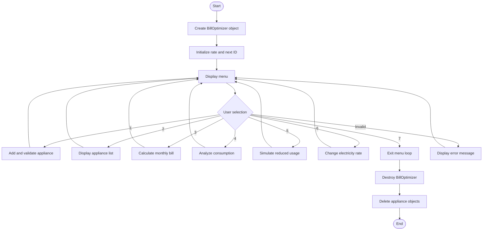

# chatgpt response

# Full Project Analysis: Electricity Bill Optimizer using C++

CSE 2100 — Object-Oriented Programming Laboratory &#124; KUET &#124; October 2026

Your project, **Electricity Bill Optimizer**, is a menu-driven C++ application that helps users estimate household electricity consumption, calculate monthly electricity expenses, identify energy-intensive appliances, and explore potential ways to reduce their bills.

I analyzed the complete 20-page project report, including the source code, UML class diagram, sample program outputs, error-handling section, and conclusion. Below is a comprehensive explanation of what the project does, how it works internally, which OOP concepts it demonstrates, and how its optimization mechanism actually operates.

## 1. The main idea behind the project
The problem addressed by your project is straightforward: people use multiple electrical appliances every day, but they may not know how much energy each appliance consumes or how much it contributes to their monthly electricity bill.

For example, a household might have\:

- Several ceiling fans running for different durations.
- Multiple lights used throughout the evening.
- A computer running for several hours daily.
- A refrigerator operating throughout the day.

Each appliance contributes to the total electricity consumption. Your program collects information about these appliances and calculates their estimated monthly energy consumption in kilowatt-hours (kWh).

It then uses the total consumption and an electricity rate to estimate the bill. More importantly, it identifies the appliance with the highest calculated energy consumption and suggests a potential change in usage.

The project therefore combines three central functions\:

**1\. Calculation**

Calculate appliance-wise energy usage, total monthly consumption, and estimated electricity cost.

---

**2\. Analysis**

Compare appliances and determine which one has the highest estimated monthly consumption.

---

**3\. Optimization**

Simulate reducing daily operating time and calculate the resulting potential energy and bill savings.

One important distinction: this is a **software-based estimation and recommendation system**, not a smart meter or an automatic electricity controller. It does not physically monitor appliances or switch them off. Its calculations depend on the information entered by the user.

## 2. What the application can do

According to the program's menu and implementation in pages 13–16, the user has seven options.

**Option 1 — Add an appliance**

The user selects an appliance category, enters its name, power rating in watts, quantity, and daily operating hours. The program validates several inputs, creates the corresponding object, and assigns it a unique ID.

**Option 2 — View all appliances**

Displays a table containing the ID, name, power rating, quantity, daily operating hours, and calculated monthly consumption of every appliance.

**Option 3 — Calculate monthly bill**

Adds the monthly energy consumption of all appliances and multiplies the total by the configured electricity rate.

**Option 4 — Analyze energy consumption**

Shows the consumption of each appliance, finds the appliance with the highest calculated consumption, and displays that appliance's recommendation.

**Option 5 — Optimize electricity cost**

Simulates reducing the daily usage of eligible appliances by one hour and calculates the possible reduction in energy consumption and cost.

**Option 6 — Change electricity rate**

Allows the user to enter a different price per kWh for bill estimation.

**Option 7 — Exit**

Terminates the menu loop and allows the application's objects to be destroyed, releasing dynamically allocated appliance objects.

The interface repeatedly displays the menu until the user selects option 7. This makes it possible to add multiple appliances and perform different analyses during one program execution.

## 3. The mathematical foundation of the project

The core of the project is its energy calculation and bill estimation. Understanding these formulas is essential because the optimization feature is built on them.

### 3.1 Monthly energy consumption

Your program uses the following formula\:

$$
E=\frac{P}{1000}\times Q\times H\times30
$$

Where\:

- $E$ \= estimated monthly energy consumption in kWh.
- $P$ \= power rating of one appliance in watts.
- $Q$ \= number of appliances.
- $H$ \= daily operating hours.
- $30$ \= assumed number of days per month.

The formula is implemented in `Appliance::calculateEnergy()` on page 11 of the report. fileciteturn0file0

Let's calculate the consumption of a computer using the sample data from your report.

### Worked example: one computer

Power rating

# 200 W

Daily usage

# 3 hours

$$
E=\frac{200}{1000}\times1\times3\times30
$$

$$
E=18\text{ kWh/month}
$$

Calculated result: 18 kWh/month

The calculation first converts watts to kilowatts because electricity consumption is measured in kilowatt-hours. It then multiplies the power by the number of appliances, daily usage, and days in the assumed month.

### 3.2 Monthly electricity bill

The bill calculation uses a second formula\:

$$
B=E_{\text{total}}\times R
$$

Where\:

- $B$ \= estimated monthly bill in taka.
- $E_{\text{total}}$ \= total monthly consumption in kWh.
- $R$ \= electricity rate in taka per kWh.

The program initially sets the rate to Tk 8.00 per kWh in the `BillOptimizer` constructor.

For the sample consumption of 421.20 kWh shown on page 18\:

$$
B=421.20\times8
$$

$$
\boxed{B=\text{Tk }3369.60}
$$

This matches the sample output in your report. The displayed estimate excludes taxes and additional charges. fileciteturn0file0

### 3.3 How the program calculates the total

The `totalEnergy()` function starts with a total of zero and loops through the vector of appliances. It calls `calculateEnergy()` for each object and adds the returned value to the running total.

For example, the three appliances in your sample output produce the following results\:

| Appliance | Monthly consumption |
|--------|--------|
| PC — 200 W, 3 h/day | 18.00 kWh |
| Six 20 W bulbs, 12 h/day | 43.20 kWh |
| Refrigerator — 500 W, 24 h/day | 360.00 kWh |
| **Total** | **421.20 kWh** |

The total is\:

$$
18+43.2+360=421.2\text{ kWh}
$$

Notice that the refrigerator dominates the calculated consumption because its entered daily operating time is 24 hours. The program assumes that the entered power rating applies throughout those hours; it does not model a refrigerator's compressor cycling on and off.

## 4. How the optimization algorithm actually works

This is the most important part of the project to understand accurately.

Your program does **not** use machine learning, artificial intelligence, dynamic programming, or a sophisticated optimization algorithm. It uses a deterministic, rule-based simulation: it calculates the original consumption, reduces the assumed operating time by one hour where possible, recalculates consumption, and compares the results.

The relevant code is in `BillOptimizer::optimizeBill()` on pages 15–16. fileciteturn0file0

### Step-by-step algorithm

**Step 1: Read an appliance**

Obtain its original energy usage and daily hours.

**Step 2: Adjust the assumed usage**

If daily usage is greater than one hour, subtract one hour. Otherwise, leave it unchanged.

**Step 3: Calculate new consumption**

Call the overloaded calculateEnergy(newHours) function.

**Step 4: Calculate potential savings**

Subtract new consumption from original consumption and multiply the difference by the electricity rate.

**Step 5: Summarize the results**

Display original total, simulated new total, and possible monthly bill savings.

### The underlying pseudocode

```text
oldTotal = 0
newTotal = 0

FOR each appliance:
    oldEnergy = appliance's current monthly energy
    newHours = appliance's daily operating hours

    IF newHours > 1:
        newHours = newHours - 1

    newEnergy = energy calculated using newHours

    oldTotal = oldTotal + oldEnergy
    newTotal = newTotal + newEnergy

    Display original usage
    Display proposed usage and savings

Display total energy before and after
Display possible monthly bill savings
```

### Why does this reduce the bill mathematically?

Since power, quantity, and days per month remain unchanged, reducing daily usage by one hour reduces monthly energy by\:

$$
\Delta E=\frac{P}{1000}\times Q\times30
$$

The corresponding estimated bill reduction is\:

$$
\Delta B=\Delta E\times R
$$

For the 200 W computer, assuming one unit and an original daily usage of three hours\:

$$
\Delta E=\frac{200}{1000}\times1\times30
=6\text{ kWh}
$$

At Tk 8 per kWh\:

$$
\Delta B=6\times8=\text{Tk }48
$$

Thus, the program reports a possible monthly saving of Tk 48 for the computer.

This result follows directly from the formula. It does not mean the program has proved that the user can comfortably reduce computer usage by one hour; that is a behavioral assumption.

### Understanding the actual sample optimization output

Your report shows the following results on page 18.

| Appliance | Original kWh/month | Simulated kWh/month | Potential saving |
|--------|--------|--------|--------|
| PC | 18.00 | 12.00 | Tk 48.00 |
| Six bulbs | 43.20 | 39.60 | Tk 28.80 |
| Refrigerator | 360.00 | 345.00 | Tk 120.00 |
| **Total** | **421.20** | **396.60** | **Tk 196.80** |

The arithmetic checks out\:

$$
421.20-396.60=24.60\text{ kWh}
$$

$$
24.60\times8=\text{Tk }196.80
$$

The estimated bill would fall from Tk 3,369.60 to Tk 3,172.80 under the simulation.

However, the program only *calculates* these potential savings. It does not change the stored operating hours, and it does not automatically update the user's appliances. The recommendation is a hypothetical scenario.

There is also an important practical limitation: reducing a refrigerator's modeled usage from 24 to 23 hours per day is not necessarily a realistic energy-saving action. The calculation assumes constant power consumption during each entered hour, which is a simplification.

## 5. Software architecture and UML class diagram

Your project uses five main classes, illustrated in the UML diagram on page 6. One class is the common base class, four represent appliance types, and one manages the application. fileciteturn0file0

**Appliance**

Base class: common data and behavior

**Fan**

Derived class

**Light**

Derived class

**Computer**

Derived class

**Refrigerator**

Derived class

**BillOptimizer**

Application controller: stores appliance pointers, manages the menu, and calculates results.

The diagram above is a conceptual view of the class relationships, not a replacement for the detailed UML diagram in the report.

### 5.1 `Appliance` — the base class

This class defines the information and common operations shared by all appliances.

Its data members are\:

| Member | Type | Purpose |
|--------|--------|--------|
| `id` | `int` | Unique ID assigned by the application |
| `name` | `string` | Appliance name |
| `power` | `double` | Rated power in watts |
| `quantity` | `int` | Number of units |
| `hours` | `double` | Daily operating hours |

The class provides\:

- Default and parameterized constructors.
- A virtual destructor.
- Getter functions for ID, name, and daily hours.
- Two versions of `calculateEnergy()`\.
- A virtual `showDetails()` function.
- A virtual `getTip()` function.

The `protected` access specifier lets derived classes access the base class's data members. It also prevents ordinary external code from directly accessing these members through the class interface.

### 5.2 The four derived classes

Each derived class represents a supported appliance category and overrides `getTip()`\.

| Class | Recommendation implemented in the code |
|--------|--------|
| `Fan` | Reduce usage when possible and switch it off when not needed. |
| `Light` | Suggest an energy-efficient LED for power ratings above 15 W; otherwise, suggest daylight and switching off unused lights. |
| `Computer` | Enable power-saving mode and shut down after use. |
| `Refrigerator` | Avoid frequent door opening and keep space around the refrigerator. |

The `Light` class contains a conditional rule\:

```cpp
if (power > 15)
    return "Consider using an energy-efficient LED light.";

return "Use daylight when possible and switch off unused lights.";
```

Therefore, the recommendation changes according to the entered power rating.

These are fixed, predefined recommendations. The system does not investigate appliance efficiency, compare actual product models, or estimate the measured effect of each recommendation.

### 5.3 `BillOptimizer` — the controller class

This class coordinates the entire application.

Its private data members are\:

```cpp
vector<Appliance*> appliances;
double rate;
int nextId;
```

Their roles are\:

- `appliances`\: stores pointers to the appliance objects.
- `rate`\: stores the current electricity price per kWh.
- `nextId`\: determines the ID of the next appliance to add.

Its member functions implement appliance addition, listing, total energy calculation, bill calculation, consumption analysis, optimization, rate changes, and the menu loop.

This separation of responsibilities is one of the project's strongest design choices: appliance-specific data and behavior live in the appliance classes, while the application-level operations live in `BillOptimizer`\.

## 6. Object-oriented programming concepts demonstrated

Since this is a CSE 2100 Object-Oriented Programming Laboratory project, the way the code uses OOP is just as important as the electricity calculations.

### 6.1 Classes and objects

A class defines the structure and behavior of a type. An object is an instance of that class.

For example\:

```cpp
class Appliance {
protected:
    int id;
    string name;
    double power;
    int quantity;
    double hours;
};
```

This defines the common structure of an appliance.

When the user adds a computer, the program creates an actual object\:

```cpp
new Computer(nextId, name, power, quantity, hours);
```

That object stores the entered data and provides the functions needed for calculation and recommendation.

### 6.2 Encapsulation

Encapsulation combines data and related functions within a class and controls access to them.

In your project, `BillOptimizer` declares its main data members under `private`\:

```cpp
private:
    vector<Appliance*> appliances;
    double rate;
    int nextId;
```

Other parts of the program interact with these members through public member functions rather than directly modifying the vector or ID counter.

One nuance: the `Appliance` class uses `protected` data members, so derived classes can directly modify them. The project demonstrates access control, although it does not use the stricter design of making all data members private and exposing controlled setters.

### 6.3 Inheritance

Inheritance allows a derived class to reuse the properties and functions of a base class.

```cpp
class Fan : public Appliance {
    // ...
};
```

The `Fan` class inherits from `Appliance`, so it has access to the common appliance information and calculation functions.

The same relationship applies to `Light`, `Computer`, and `Refrigerator`\.

This avoids defining an entirely separate set of energy-calculation logic for every appliance type.

### 6.4 Polymorphism

Polymorphism allows the same interface to produce different behavior depending on the actual object.

Your base class declares\:

```cpp
virtual string getTip() const {
    return "Switch off the appliance when it is not needed.";
}
```

The derived classes override this function with their own recommendations.

Later, the program uses a base-class pointer\:

```cpp
appliances[i]->getTip();
```

If the pointer refers to a `Fan`, the fan recommendation is returned. If it refers to a `Light`, the light recommendation is returned.

This is **runtime polymorphism**, enabled by the virtual function and overridden implementations.

Your project also demonstrates function overloading\:

```cpp
double calculateEnergy() const;

double calculateEnergy(double newHours) const;
```

Both functions have the same name but different parameter lists. The first calculates energy using the stored daily hours, while the second calculates it using a supplied number of hours.

**Important distinction\:** function overloading is compile-time polymorphism, while overriding `getTip()` through a virtual function demonstrates runtime polymorphism.

### 6.5 Constructors and destructors

The default constructor initializes an appliance with values such as ID `0`, name `"Unknown"`, quantity `1`, and zero power and hours.

The parameterized constructor initializes an appliance using the supplied data.

The derived classes also have parameterized constructors. In the current code, they assign values directly to inherited `protected` members instead of passing those values to the base-class constructor through an initializer list.

The program's main function creates the controller\:

```cpp
int main() {
    BillOptimizer app;
    app.run();
    return 0;
}
```

When `main()` ends, the `BillOptimizer` destructor runs. It deletes every dynamically allocated appliance object.

The base class has a virtual destructor\:

```cpp
virtual ~Appliance() {}
```

This is important because the program deletes derived objects through base-class pointers. A virtual base destructor ensures that the correct derived-class destructor is invoked.

The memory-management design is appropriate for demonstrating dynamic allocation and destruction, although modern C++ would generally favor smart pointers to manage ownership more safely.

## 7. How the program executes internally

The overall program flow can be summarized as follows.



The `run()` function uses a `do-while` loop, so the menu appears at least once. A `switch` statement dispatches the user's choice to the appropriate member function.

When an appliance is added, the program validates the selected category and the numerical ranges before constructing the relevant derived object. The pointer to that object is stored in the vector.

The same stored objects are then used for listing, energy calculation, analysis, and optimization. The program does not need to create a new appliance object every time one of these operations is performed.

## 8. Header files and C++ features

The report lists four standard-library headers on page 7. fileciteturn0file0

| Header | Role in your project |
|--------|--------|
| `<iostream>` | Console input and output using `cin` and `cout` |
| `<string>` | Stores appliance names and textual recommendations |
| `<vector>` | Stores a dynamically growing collection of appliance pointers |
| `<iomanip>` | Formats tabular output using `setw`, `left`, `fixed`, and `setprecision` |

The code also uses several other important language features\:

- `const` member functions for operations that do not modify the object's state.
- `override` to indicate that derived classes replace a virtual base-class function.
- `switch`, `if-else`, and loops for control flow.
- `new` and `delete` for dynamic memory allocation and deallocation.
- `using namespace std;` to avoid repeatedly writing the `std::` prefix.
- `DAYS_PER_MONTH` as a named constant for the 30-day assumption.

The project does not require a third-party library. It uses standard C++ library facilities and can be compiled with a compatible C++ compiler.

## 9. Testing and results documented in the report

The report's sample screenshots on pages 17–18 illustrate several stages of operation.

**Basic interface and appliance entry**

The menu is displayed, and the user enters the appliance type, name, power, quantity, and daily usage. The sample adds a PC rated at 200 W, quantity 1, and three hours per day.

---

**Appliance listing**

The application displays appliance information in aligned columns, including calculated monthly energy. The sample table contains a PC, six living-room bulbs, and a refrigerator.

---

**Bill calculation and optimization**

The report shows a total of 421.20 kWh, an estimated bill of Tk 3,369.60, and simulated savings of Tk 196.80 per month.

The original report's screenshots are the primary evidence of the displayed results; the images above are illustrative examples of the interface style.

### 9.1 Input validation

According to section 5.1, the program checks the following conditions\:

| Test case | Expected behavior |
|--------|--------|
| Invalid menu selection | Display an error message |
| Unsupported appliance type | Reject the selection |
| Zero or negative power | Reject the appliance |
| Zero or negative quantity | Reject the appliance |
| Daily usage below 0 or above 24 hours | Reject the appliance |
| Negative electricity rate | Reject the new rate |
| Non-numeric input | Not fully handled |

These checks are useful, but they do not constitute complete input validation.

For example, the code reads the power rating using `cin >> power`\. If a user types text instead of a number, the input stream can enter a failed state. Subsequent reads may fail too, potentially preventing the menu from operating as intended.

A robust version should detect `cin.fail()`, clear the stream state, discard the invalid input, and prompt the user again. The current implementation also accepts a zero electricity rate, which is mathematically valid even if it may not reflect a real tariff.

### 9.2 Development time

Section 5.2 reports the following approximate effort\:

Design and planning

## 2–3 hours

Coding and debugging

## 5–6 hours

---

Testing and improvement

## 2–3 hours

Reported total

# Approximately 10 hours

These are the development estimates recorded in the report, not independently measured timings.

## 10. Critical technical evaluation

The project achieves its main objectives as a beginner-to-intermediate OOP laboratory application. However, a few distinctions are important when assessing its technical correctness.

### What the project does well

- **Clear class structure\:** Common appliance data and specialized recommendations are separated into appropriate classes.
- **Reusable calculations\:** The energy formula is implemented once in the base class and reused by the derived classes.
- **Dynamic collection\:** A vector permits the user to add multiple appliances without declaring a fixed-size array.
- **Memory management\:** A virtual base destructor and controller destructor support cleanup of dynamically allocated objects.
- **Readable interface\:** The menu and formatted output make the program easy to operate and demonstrate.
- **Verifiable arithmetic\:** The sample bill and optimization totals are mathematically consistent with the inputs and the configured rate.

### Limitations that matter

**1\. The optimization is a simulation, not a search algorithm**

It tests one predetermined change—reducing eligible daily usage by one hour. It does not search multiple possible schedules, compare alternative combinations, or find a mathematically optimal usage plan.

**2\. Electricity consumption is simplified**

The formula assumes constant power draw during entered operating hours. Real appliances may have variable power consumption, standby usage, duty cycles, and changing operating conditions.

**3\. The bill model uses a single rate**

It does not implement slab-based tariffs, taxes, fixed charges, or other billing adjustments. The report explicitly acknowledges this limitation.

**4\. Data is not persistent**

Appliance information exists only during the current program execution. Closing the program loses the appliance list and the user's changes to the rate.

**5\. Some C++ safety concerns remain**

The vector owns raw pointers, so copying a `BillOptimizer` object without implementing appropriate copy semantics could result in double deletion. The current `main()` does not copy it, but smart pointers or carefully defined ownership would improve the design.

**6\. The highest-consumption result is entry-based**

`analyzeEnergy()` compares the consumption of each individual object in the vector. If several separate entries represent the same appliance category, it does not combine them into a category-wide total.

Another subtle point: `showDetails()` is declared virtual in the base class, but the derived classes do not override it. It therefore uses the same implementation for all appliance types. The demonstrated runtime specialization occurs mainly through `getTip()`\.

These are opportunities for improvement rather than reasons to dismiss the project. The existing implementation is sufficient to demonstrate the central concepts specified in the laboratory problem statement.

## 11. Future development possibilities

Your report proposes five future improvements: data persistence, improved input validation, usage history, enhanced optimization, and a graphical interface. These can be developed incrementally.

| Improvement | Suggested implementation |
|--------|--------|
| Permanent storage | Save appliance information in a file and reload it at startup |
| Robust input validation | Validate input types, handle stream failures, and reprompt users |
| Monthly history | Record consumption and compare successive months |
| Better optimization | Compare different usage reductions and rank savings against user-defined constraints |
| Graphical interface | Add a GUI for appliance entry, bills, and consumption charts |

For the optimization feature specifically, a more meaningful next step would be to let the user specify which appliances can have their operating hours reduced and by how much. The program could then compare scenarios and rank them by estimated savings.

A genuine optimization problem would require an objective—such as minimizing total cost—along with constraints representing acceptable operating hours and required appliance usage. The current project does not yet model those constraints.

## 12. Overall assessment

The Electricity Bill Optimizer is a compact, practical C++ project that applies object-oriented programming to a recognizable household problem. Its strongest educational contribution is the integration of classes, inheritance, virtual functions, constructors, destructors, dynamic memory management, vectors, control flow, and arithmetic calculations into one working application.

The complete workflow is\:

1. Collect appliance specifications from the user.
2. Represent appliances as objects of the appropriate classes.
3. Calculate monthly consumption using power, quantity, and operating time.
4. Sum consumption and estimate the electricity bill.
5. Identify the highest-consuming appliance entry and show a relevant tip.
6. Simulate reduced operating hours and estimate potential savings.
7. Repeat until the user exits.

The most important point to remember is that **the project estimates electricity usage and simulates cost-saving scenarios; it does not directly control electricity consumption or guarantee savings**\.

As a CSE 2100 laboratory project, it demonstrates the intended OOP concepts in a coherent application. Its main opportunities for improvement are more realistic energy modeling, stronger input validation, persistent data storage, safer resource ownership, and a more comprehensive optimization strategy. The report's conclusion and future-work section identify several of these same directions. fileciteturn0file0

![Is 3KW of Solar System Enough for a Home? \[Customer Review\]](https://images.openai.com/static-rsc-4/4u0YodYAbwb55bV3JilxnI_DI_csWHyFoxK5mxtCI87OqonyDC9EYZeguObPRaQHc-biTD3CAkGYzF7Es8LQyggIW_3pYW3veLHEt2c_gQpEe5T_bjA9srQg5ZNiZNOacdJviqq9Ajs8-I3BbBYPoVZXwGgDbAbcqwV03Fe2Lq8apdmxPvVoSpA8A2UMerY1?purpose=fullsize)


---
Powered by [AI Exporter](https://saveai.net)