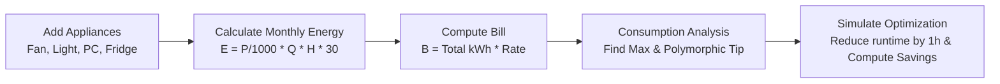

# CSE 2100: Object-Oriented Programming Laboratory

[](https://en.wikipedia.org/wiki/C%2B%2B)
[](https://www.kuet.ac.bd)
[]()
[]()
[](SECURITY.md)
[](LICENSE)

Welcome to the comprehensive repository for **CSE 2100: Object-Oriented Programming Laboratory**, taught in the Department of Computer Science and Engineering at **Khulna University of Engineering & Technology (KUET)**.

This repository serves as an educational archive and reference containing **in-class practice codes**, **weekly laboratory assignments**, and the final term project, **Electricity Bill Optimizer**.

---

## 📑 Table of Contents

- [Repository Architecture](#-repository-architecture)
- [Class Work Practice Index](#-class-work-practice-index)
- [Weekly Lab Assignments](#-weekly-lab-assignments)
  - [Lab 01: Encapsulation & Basic Classes](#lab-01-encapsulation--basic-classes)
  - [Lab 02: Friend Functions & Inter-Object Operations](#lab-02-friend-functions--inter-object-operations)
  - [Lab 03: Constructors, Destructors & Deep Copying](#lab-03-constructors-destructors--deep-copying)
  - [Lab 04: Advanced Inheritance & The Diamond Problem](#lab-04-advanced-inheritance--the-diamond-problem)
  - [Lab 05: Operator Overloading & Virtual Polymorphism](#lab-05-operator-overloading--virtual-polymorphism)
- [Term Project: Electricity Bill Optimizer](#-term-project-electricity-bill-optimizer)
- [Compilation & Execution Guide](#-compilation--execution-guide)
- [Code Quality & Security](#-code-quality--security)
- [License](#-license)

---

## 🗂️ Repository Architecture

The codebase is organized into clean, self-contained directories. Compiled binaries (`*.exe`, `*.o`) are gitignored to preserve repository integrity, while visual outputs and problem specifications reside in dedicated `assets/` subfolders:

```text
├── .gitignore                   # C++ build artifacts, IDE configs, OS files
├── LICENSE                      # MIT Open Source License
├── README.md                    # Main repository documentation & guide
├── SECURITY.md                  # Security policy, vulnerability reporting & RAII guidelines
│
├── Class_Work/                  # 24 Progressive OOP exercises (Fundamentals -> Advanced)
│   ├── kankon-01.cpp            # Class & object basics (Employee)
│   ├── ...                      # Step-by-step concept implementations
│   └── kankon-24.cpp            # Operator overloading with Euclidean distance
│
├── Lab_01/                      # Lab Assignment 01
│   ├── assets/                  # Problem statements and I/O screenshots
│   └── Lab-01.cpp               # SocialMedia usage tracking class
│
├── Lab_02/                      # Lab Assignment 02
│   ├── assets/                  # Problem statements and execution captures
│   ├── lab-02-01.cpp            # Temperature conversion and threshold comparison
│   ├── lab-02-02.cpp            # Time arithmetic and minute normalization
│   └── lab-02-03.cpp            # Laptop & Phone interaction via friend classes
│
├── Lab_03/                      # Lab Assignment 03
│   ├── assets/                  # Problem statements and execution captures
│   ├── LAB-03-01.cpp            # Rectangle geometry with constructor chaining
│   ├── LAB-03-02.cpp            # Complex arithmetic engine using friend functions
│   └── LAB-03-03.cpp            # Custom String class with dynamic heap allocation & deep copy
│
├── Lab_04/                      # Lab Assignment 04
│   ├── assets/                  # Problem statements and execution captures
│   ├── LAB-04-01.cpp            # Multilevel inheritance (ElectronicDevice -> Sensor -> TempSensor)
│   ├── LAB-04-02.cpp            # Hierarchical & Multiple inheritance (SmartHome ecosystem)
│   └── LAB-04-03.cpp            # Virtual Base Classes solving the Diamond Problem
│
├── Lab_05/                      # Lab Assignment 05
│   ├── assets/                  # Problem statements and execution captures
│   ├── LAB-05-01.cpp            # Device power modeling via operator overloading
│   └── LAB-05-02.cpp            # RPG combat engine using runtime virtual dispatch
│
└── Project/                     # Final Term Project: Electricity Bill Optimizer
    ├── assets/                  # UML diagrams and 5 terminal execution screenshots
    ├── CSE 2100 Lab Project.pdf # 20-page official project report & specification
    ├── details.md               # Technical project breakdown and mathematical analysis
    ├── Electricity_Bill_Optimizer.cpp # Complete project source code
    └── README.md                # Dedicated, comprehensive project documentation
```

---

## 💻 Class Work Practice Index

The [`Class_Work/`](Class_Work/) directory contains 24 standalone C++ programs developed during classroom sessions. They systematically explore the core mechanics of modern C++ OOP:

| File | Primary Topic | Core Classes / Concepts Implemented |
| :--- | :--- | :--- |
| [`kankon-01.cpp`](Class_Work/kankon-01.cpp) | **Basic Classes & Objects** | `Employee` class; public member functions; state input/output. |
| [`kankon-02.cpp`](Class_Work/kankon-02.cpp) | **Encapsulation & Access Control** | `Car` class; `private` member variables; `public` getters/setters. |
| [`kankon-03.cpp`](Class_Work/kankon-03.cpp) | **Friend Functions (Basics)** | `Complex` numbers; non-member friend function accessing private real/imaginary parts. |
| [`kankon-04.cpp`](Class_Work/kankon-04.cpp) | **Friend Functions with Objects** | `Complex` arithmetic passing objects by reference to friend functions. |
| [`kankon-05.cpp`](Class_Work/kankon-05.cpp) | **Forward Declaration & Friends** | Forward class declaration `Complex2`; bridging two separate classes. |
| [`kankon-06.cpp`](Class_Work/kankon-06.cpp) | **Friend Class Interoperability** | Full friend class granting member-level access across class boundaries. |
| [`kankon-07.cpp`](Class_Work/kankon-07.cpp) | **C++ Driver Skeleton** | Minimal structured template for standard console execution. |
| [`kankon-08.cpp`](Class_Work/kankon-08.cpp) | **Default Constructors** | `Student` class; automated default state initialization. |
| [`kankon-09.cpp`](Class_Work/kankon-09.cpp) | **Parameterized Constructors** | Dynamic initialization using argument-driven constructor overloads. |
| [`kankon-10.cpp`](Class_Work/kankon-10.cpp) | **Constructor Overloading** | Multiple constructor prototypes providing flexible instantiation options. |
| [`kankon-11.cpp`](Class_Work/kankon-11.cpp) | **Constructors with Default Arguments** | Single consolidated constructor handling optional arguments seamlessly. |
| [`kankon-12.cpp`](Class_Work/kankon-12.cpp) | **Copy Constructors** | Shallow vs. explicit copy constructor initialization (`Student s2 = s1`). |
| [`kankon-13.cpp`](Class_Work/kankon-13.cpp) | **Destructors & Lifecycle** | Automatic destructor invocation; scope-based resource deallocation. |
| [`kankon-14.cpp`](Class_Work/kankon-14.cpp) | **Arrays of Objects** | `TemperatureRecord` objects in contiguous arrays; batch statistical processing. |
| [`kankon-15.cpp`](Class_Work/kankon-15.cpp) | **Single Inheritance** | `Person` base class $\to$ `Student` derived class; code reuse. |
| [`kankon-16.cpp`](Class_Work/kankon-16.cpp) | **Protected Access Specifier** | Allowing derived access while preventing external modification. |
| [`kankon-17.cpp`](Class_Work/kankon-17.cpp) | **Multilevel Inheritance** | `Person` $\to$ `Employee` $\to$ `Teacher` inheritance chain. |
| [`kankon-18.cpp`](Class_Work/kankon-18.cpp) | **Multiple Inheritance** | Deriving from multiple distinct base classes simultaneously. |
| [`kankon-19.cpp`](Class_Work/kankon-19.cpp) | **Hierarchical Inheritance** | One base class (`Person`) branching into multiple derived classes (`Student`, `Teacher`). |
| [`kankon-20.cpp`](Class_Work/kankon-20.cpp) | **Function Overloading** | Compile-time polymorphism; signature-differentiated function variants. |
| [`kankon-21.cpp`](Class_Work/kankon-21.cpp) | **Operator Overloading (`+`)** | Custom binary `operator+` implementation for domain entities. |
| [`kankon-22.cpp`](Class_Work/kankon-22.cpp) | **Function Overriding** | Runtime polymorphism; base vs. derived method resolution. |
| [`kankon-23.cpp`](Class_Work/kankon-23.cpp) | **Abstraction & Pure Virtuals** | Abstract base class interfaces requiring derived class implementation. |
| [`kankon-24.cpp`](Class_Work/kankon-24.cpp) | **Operator Overloading Application** | `Distance` class overloading `+` to compute 2D Euclidean distance. |

---

## 🔬 Weekly Lab Assignments

### Lab 01: Encapsulation & Basic Classes
- **Folder**: [`Lab_01/`](Lab_01/)
- **Core Concept**: Introduction to C++ object modeling, standard console I/O, data hiding.
- **Problem**: Model a `SocialMedia` tracking system that records platform names, daily screen time, and displays analytical consumption data.
- **Files**:
  - [`Lab-01.cpp`](Lab_01/Lab-01.cpp): Implementation of the `SocialMedia` class.
  - [`Lab_01/assets/`](Lab_01/assets/): Official question prompt ([`Lab-01.png`](Lab_01/assets/Lab-01.png)) and verified execution screenshot ([`Lab-01-IO.png`](Lab_01/assets/Lab-01-IO.png)).

---

### Lab 02: Friend Functions & Inter-Object Operations
- **Folder**: [`Lab_02/`](Lab_02/)
- **Core Concept**: Object passing, member vs. non-member functions, friend classes.
- **Problems & Files**:
  - [`lab-02-01.cpp`](Lab_02/lab-02-01.cpp): `Temperature` class converting Celsius, Fahrenheit, and Kelvin with comparison member functions.
  - [`lab-02-02.cpp`](Lab_02/lab-02-02.cpp): `Time` class implementing inter-object addition with 60-minute normalization.
  - [`lab-02-03.cpp`](Lab_02/lab-02-03.cpp): Cross-device communication between `Laptop` and `Phone` enabled via friend declarations.
  - [`Lab_02/assets/`](Lab_02/assets/): Problem statements and execution outputs for all three tasks.

---

### Lab 03: Constructors, Destructors & Deep Copying
- **Folder**: [`Lab_03/`](Lab_03/)
- **Core Concept**: Memory management, copy constructors, dynamic heap arrays (`new`/`delete`).
- **Problems & Files**:
  - [`LAB-03-01.cpp`](Lab_03/LAB-03-01.cpp): `Rectangle` class demonstrating parameterized constructors, copy constructors, and destructor tracking.
  - [`LAB-03-02.cpp`](Lab_03/LAB-03-02.cpp): Mathematical `Complex` number arithmetic engine utilizing friend operators.
  - [`LAB-03-03.cpp`](Lab_03/LAB-03-03.cpp): Custom `String` class with heap-allocated `char*` arrays, deep copying, and dynamic concatenation to prevent dangling pointers.
  - [`Lab_03/assets/`](Lab_03/assets/): Complete set of task prompts and terminal captures.

---

### Lab 04: Advanced Inheritance & The Diamond Problem
- **Folder**: [`Lab_04/`](Lab_04/)
- **Core Concept**: Single, multilevel, hierarchical, multiple, and hybrid inheritance; virtual base classes.
- **Problems & Files**:
  - [`LAB-04-01.cpp`](Lab_04/LAB-04-01.cpp): Multilevel hierarchy: `ElectronicDevice` $\to$ `Sensor` $\to$ `TemperatureSensor`.
  - [`LAB-04-02.cpp`](Lab_04/LAB-04-02.cpp): Smart home IoT ecosystem implementing hierarchical and multiple inheritance (`SmartLight`, `SmartSpeaker`, `SmartHub`).
  - [`LAB-04-03.cpp`](Lab_04/LAB-04-03.cpp): Autonomous electric vehicles modeling hybrid diamond inheritance:
    ```mermaid
    flowchart TD
        Vehicle --> ElectricVehicle
        Vehicle --> AutonomousVehicle
        ElectricVehicle --> AutonomousElectricVehicle
        AutonomousVehicle --> AutonomousElectricVehicle
    ```
    Resolved ambiguity cleanly using `virtual public Vehicle`.
  - [`Lab_04/assets/`](Lab_04/assets/): Problem diagrams and terminal I/O captures.

---

### Lab 05: Operator Overloading & Virtual Polymorphism
- **Folder**: [`Lab_05/`](Lab_05/)
- **Core Concept**: Compile-time vs. runtime polymorphism, virtual method tables (vtable), dynamic dispatch.
- **Problems & Files**:
  - [`LAB-05-01.cpp`](Lab_05/LAB-05-01.cpp): `Device` class with overloaded arithmetic operators and power-consumption metrics.
  - [`LAB-05-02.cpp`](Lab_05/LAB-05-02.cpp): Polymorphic RPG battle simulator featuring an abstract `Character` base class with specialized derived classes (`Warrior`, `Mage`, `Archer`) dispatched dynamically through base pointers.
  - [`Lab_05/assets/`](Lab_05/assets/): Problem specifications and combat logs.

---

## ⚡ Term Project: Electricity Bill Optimizer

- **Project Directory**: [`Project/`](Project/)
- **Dedicated Project Readme**: [`Project/README.md`](Project/README.md)
- **Source Code**: [`Project/Electricity_Bill_Optimizer.cpp`](Project/Electricity_Bill_Optimizer.cpp)
- **Technical Analysis & Math**: [`Project/details.md`](Project/details.md)
- **Official 20-Page Report**: [`Project/CSE 2100 Lab Project.pdf`](Project/CSE%202100%20Lab%20Project.pdf)
- **Project Assets & UML Diagram**: [`Project/assets/`](Project/assets/)

### Project Synopsis
The **Electricity Bill Optimizer** is an interactive, menu-driven C++ application designed to audit domestic appliance energy consumption, calculate monthly utility expenses, identify peak energy hogs, and simulate potential monetary savings through usage curtailment.



### Highlights:
- **Architecture**: `Appliance` base class extended by `Fan`, `Light`, `Computer`, and `Refrigerator`, coordinated by a controller class `BillOptimizer`.
- **Runtime Polymorphism**: Virtual advice generator `virtual string getTip() const` dispatched through base-class pointers.
- **Overloading**: `calculateEnergy()` overloaded for original versus simulated usage hours.
- **Defensive Design**: Built-in boundary validation guarding wattages, operating hours, and tariff inputs.

For full architecture details, worked mathematical proofs, UML diagrams, and execution screenshots, see the **[Project README](Project/README.md)**.

---

## 🛠️ Compilation & Execution Guide

Any standard C++ compiler supporting **C++11 or higher** (`g++`, `clang++`, or `MSVC`) can compile all files in this repository.

### Compile an Individual Lab or Practice File
Using `g++`:
```bash
# Example 1: Compile a classwork practice file
g++ -std=c++11 -Wall -O2 "Class_Work/kankon-24.cpp" -o kankon-24

# Example 2: Compile a lab assignment
g++ -std=c++11 -Wall -O2 "Lab_04/LAB-04-03.cpp" -o lab4_diamond

# Example 3: Compile the final term project
g++ -std=c++11 -Wall -O2 "Project/Electricity_Bill_Optimizer.cpp" -o Electricity_Bill_Optimizer
```

### Run Executables

**On Windows (PowerShell / Command Prompt)**:
```powershell
.\kankon-24.exe
.\Electricity_Bill_Optimizer.exe
```

**On Linux / macOS**:
```bash
./kankon-24
./Electricity_Bill_Optimizer
```

---

## 🛡️ Code Quality & Security

- **Safe Memory Deallocation**: All dynamic allocations (`new`) are paired with appropriate deletions (`delete` / `delete[]`) or coordinated in class destructors with virtual base destructors (`virtual ~Base()`).
- **Input Integrity**: Numerical values are sanity-checked against boundary limits.
- **Responsible Disclosure**: Review our guidelines for vulnerability reporting, input buffer validation, and resource safety in [`SECURITY.md`](SECURITY.md).

---

## 📜 License

This repository is licensed under the **MIT License**. You are free to use, study, modify, and distribute this educational material with proper attribution. See the [`LICENSE`](LICENSE) file for complete terms.

---

*Department of Computer Science and Engineering (CSE), Khulna University of Engineering & Technology (KUET).*
